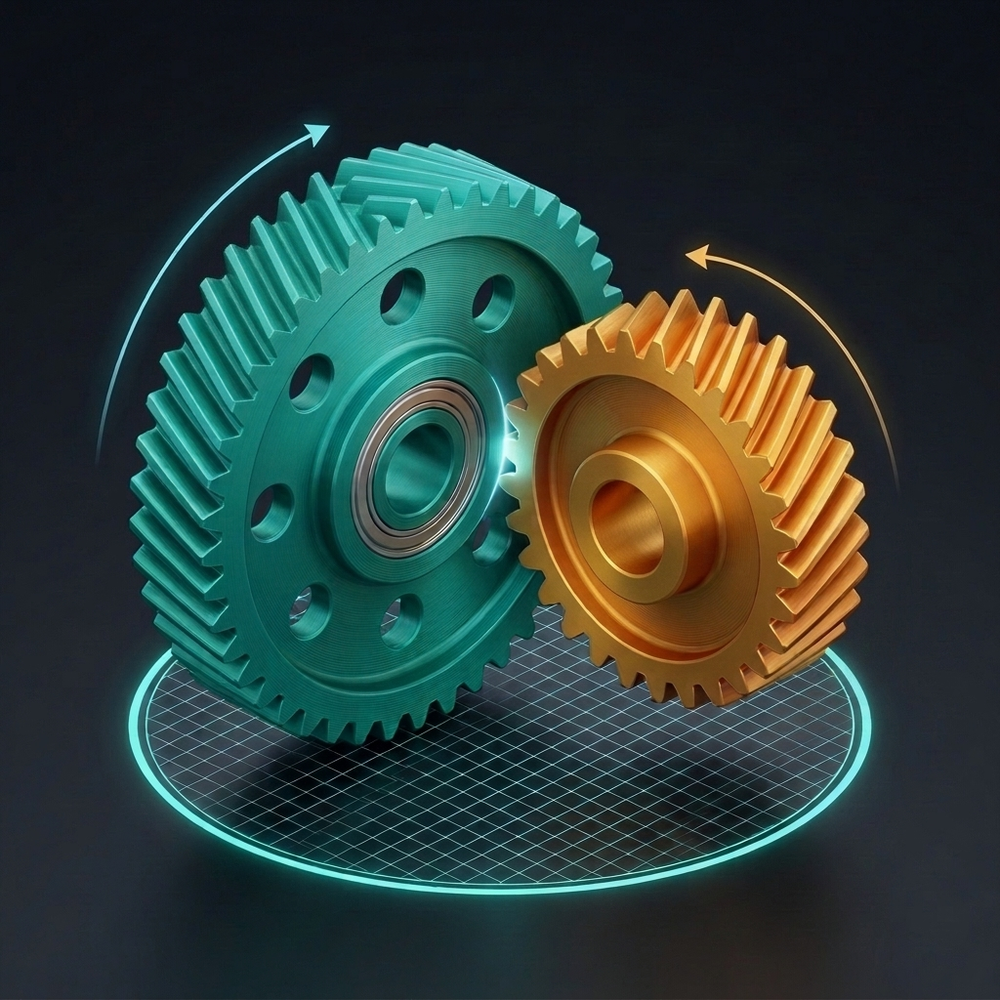

# Orca Gear Studio (`orca_gear_generator`)

**1.4.2: publicação automática / automatic publishing.** Publicar uma release no GitHub envia o pacote verificado ao OrcaCloud, após aprovação da CI. Corrigido o envio de notas com Unicode e ponto e vírgula. O fluxo usa credenciais temporárias e verifica o pacote publicado. / Publishing a GitHub release uploads the verified package to OrcaCloud after CI approval.


<p align="center">
  
</p>

Plugin nativo em Python para **OrcaSlicer 2.5.1+** que adiciona um estúdio CAD paramétrico 3D interativo (WebGL2 + lupa cinemática 2D) para engenharia, simulação de giro, calibração de folgas e fabricação aditiva FDM de engrenagens cilíndricas retas (*Spur*), helicoidais (*Helical* até 60°, incluindo 45° sem suporte) e espinha de peixe (*Herringbone*), com envio em 1 clique direto para a mesa de impressão (*Plater*) e ajuste automático de fatiamento mecânico estrutural.

**Versão 1.4.1 / Patch:** a aba superior agora se chama **Gear Studio** em todos os idiomas. The native top-bar tab is now named **Gear Studio** across interface languages. Feche e reabra o OrcaSlicer após atualizar / Close and reopen OrcaSlicer after updating.

**Versão 1.4.0:** seletor offline com **Português, English, Español, Italiano, Français, Deutsch e 日本語** na aba e no painel. A escolha manual fica salva e sincronizada; sem escolha, o plugin acompanha o idioma compatível do OrcaSlicer. Presets pessoais, nomes e números permanecem intactos. O bundle compacta apenas os dados de interface/tradução; a prévia libera as linhas de arame e os buffers do kit quando deixam de ser usados. A geometria de fabricação é idêntica à versão 1.3.1. Veja [idiomas, medições e limites / languages, measurements and limitations](docs/LANGUAGES_AND_PERFORMANCE.md).

**Idiomas modulares:** para disponibilizar outro idioma, adicione apenas um JSON em `src/gear_studio/locales/`, gere os instaladores e reinicie o Orca. O seletor e a detecção regional reconhecem o arquivo automaticamente; não é preciso alterar Python/JavaScript. Veja o [formato e o exemplo de contribuição](docs/LANGUAGES_AND_PERFORMANCE.md#adicionar-outro-idioma).

---

## Principais Recursos

- **Dupla Integração Nativa no OrcaSlicer**:
  1. **Aba Superior (`Gear Studio`)**: Estúdio de engenharia completo em 3 colunas ao lado de *Preparar / Visualizar / Dispositivo*.
  2. **Painel Lateral Acoplado (`Orca Gear Studio - Painel Lateral`)**: Acessível em *Arquivo -> Plugins -> Executar*, abrindo um painel compacto acoplado à direita da mesa 3D do OrcaSlicer.
- **Geometria Evolvente ISO 21771 / ISO 53 de Precisão**:
  - **Retas (`spur`)**, **Helicoidais (`helical`, 0°–60° com atalho 45° auto-suportado)** e **Espinha de Peixe (`herringbone`)** com mãos opostas automáticas entre Pinhão ($G_1$) e Coroa ($G_2$).
  - Controle duplo de altura de dente em fator adimensional + milímetros reais (`addendum_coeff`, `clearance_coeff`, `root_fillet_coeff`, `tip_chamfer_coeff`), perfis *Stub* de alto torque ou *Alto Contato*, correção automática de perfil (*Profile Shift* $x_1, x_2$) contra *undercut* em micro-pinhões (ex.: 9 dentes) e chanfro anti-pé-de-elefante nas faces inferior/superior.
- **Micro-Simulação Interativa de Giro 3D + Lupa 2D de Engrenamento**:
  - Barra dedicada de transporte cinemático: **Play / Pause**, inversão **CW / CCW**, controle de **RPM**, *scrubbing* angular passo a passo (`0.1°`) e ajuste ao vivo de desvio entre centros ($\Delta a$) enquanto as engrenagens giram!
  - **Lupa 2D Sincronizada**: Exibe perfis evolventes reais, círculos primitivos e de base, **Linha de Ação** ($\alpha_{tw}$), pontos de contato móveis, razão de contato ($\varepsilon_\gamma$) e **detecção física de interferência / travamento em tempo real**.
  - Indicadores vetoriais de forças tangencial ($F_t$), radial ($F_r$) e empuxo axial ($F_a$, evidenciando o empuxo líquido nulo em *Herringbone*).
- **Corpos Mecânicos Completos e 100% 2-Manifold (Estanques)**:
  - Furos independentes para Pinhão e Coroa: **Maciço (`none`)**, **Circular (`round`)**, **Eixo-D (`d_shaft`)**, **Duplo-D (`double_d`)**, **Sextavado (`hex`)** e **Rasgo de Chaveta DIN (`keyway`)**.
  - Cubo saliente (*Hub*), alojamento de rolamento/parafuso (*Recess* superior, inferior ou duplo — ex.: rolamento **608ZZ** Ø22.2×7mm), alma rebaixada (*Web Recess*) e furos circulares de alívio de massa (*Lightening Holes*).
- **Kit Rápido de Calibração de Encaixe FDM (`fit_test_kit`)**:
  - Imprime em ~10 minutos apenas **2 setores dentados de 5 dentes** + **base gabarito com 2 pinos na distância exata entre centros** + **régua calibradora de eixo com 4 folgas progressivas** (`-0.05`, `0.00`, `+0.05`, `+0.10 mm`) marcada com entalhes de identificação (`1..4`).
- **Integração Multiplataforma Direta com a Mesa (Windows & macOS) e Fatiamento Estrutural**:
  - Envia as peças selecionadas (`Par Separado`, `Apenas Pinhão`, `Apenas Coroa`, `Kit de Teste Rápido` ou `Conjunto Completo`) **in-process** sem precisar disparar subprocessos externos:
    - **Windows (`win32`)**: `WM_COPYDATA` direto para o `MainFrame` `wxWindowNR` do OrcaSlicer.
    - **macOS (`darwin`, Apple Silicon `arm64` & Intel `x86_64`)**: chamada nativa Objective-C Cocoa na fila principal (`_dispatch_main_q` → `[NSApp.delegate application:NSApp openFiles:...]`, `GUI_App::MacOpenFiles`) + abertura nativa no Finder via `NSWorkspace`.
  - Configura automaticamente em *thread* assíncrona o fatiamento mecânico ideal: desativa modo vaso (`spiral_mode = "0"`), calcula `wall_loops` de **4 a 6 perímetros** para dentes 100% maciços, **5 camadas** de topo/base, preenchimento **Gyroid 35%** e compensação de pé de elefante (`0.15 mm`).
  - Exportação direta para `.3mf` multi-objeto (com empacotamento automático 2D na mesa sem sobreposição) ou `.stl` binário.

---

## Estrutura do Projeto

```text
orca-gear-generator/
├── pyproject.toml
├── README.md
├── scripts/
│   └── build_and_install.py          # Empacotador PEP 723 single-file + instalador local
├── src/
│   └── gear_studio/
│       ├── __init__.py
│       ├── schema.py                 # Schema unificado e normalização de parâmetros
│       ├── involute_math.py          # Matemática evolvente ISO 21771, hélice e contornos 2D
│       ├── fit_and_kinematics.py     # Cinemática, forças, razão de contato e colisão 2D
│       ├── mesh_generator.py         # Motor 3D estritamente 2-manifold + Kit de Teste Rápido
│       ├── presets_catalog.py        # 12 presets mecânicos PT/EN, presets do usuário e randomizador
│       ├── exporters.py              # Exportadores STL binário e 3MF multi-objeto c/ layout 2D
│       ├── studio_ui.py              # Estúdio HTML5 + CSS3 + WebGL2 + Lupa 2D offline
│       ├── plugin_main.py            # Bridge nativo `orca` (Pages + Script Dock + Process Presets)
│       └── icon.svg                  # Ícone vetorial técnico de engrenagens acopladas
├── dist/
│   └── orca_gear_generator.py        # Bundle único PEP 723 pronto para distribuição
└── tests/                            # Suíte automatizada de matemática, topologia manifold e bridge
```

---

## Compilação e Instalação Local (Windows & macOS)

Execute o script de empacotamento e instalação usando o Python 3.12+ (embutido do OrcaSlicer ou do sistema):

### Windows (PowerShell)
```powershell
& "C:\Program Files\OrcaSlicer\python\python.exe" scripts/build_and_install.py
```
Instala em: `%APPDATA%\OrcaSlicer\orca_plugins\orca_gear_generator\`

### macOS (Terminal — Apple Silicon & Intel)
```bash
python3 scripts/build_and_install.py
```
Instala em: `~/Library/Application Support/OrcaSlicer/orca_plugins/orca_gear_generator/`

*(Alternativa rápida no Mac sem compilar novamente: basta copiar os 2 arquivos já prontos `dist/orca_gear_generator.py` e `src/gear_studio/icon.svg` para `~/Library/Application Support/OrcaSlicer/orca_plugins/orca_gear_generator/`!)*

O script:
1. Compila os módulos de `src/gear_studio/` em um único arquivo `dist/orca_gear_generator.py` com cabeçalho **PEP 723** (`# /// script`).
2. Executa verificação automática (*smoke test*) de carregamento, registro `@orca.plugin`, geração de HTML (`page` e `dock`) e protocolo de mensagens.
3. Instala estritamente `orca_gear_generator.py` e `icon.svg` no diretório de plugins do OrcaSlicer do sistema operacional atual (preservando `.install_state.json` e sem criar `__pycache__`).

### Como Ativar no OrcaSlicer
1. Abra (ou reinicie) o **OrcaSlicer 2.5.1+**.
2. Acesse **Plugins -> Gerenciar Plugins** (*Manage Plugins*), habilite **Orca Gear Studio** e aceite as permissões locais solicitadas (leitura/escrita na pasta de dados e *threading* — zero permissão de subprocesso externo!).
3. Clique na aba superior **Gear Studio** (ou abra o painel lateral via **Arquivo -> Plugins -> Orca Gear Studio - Painel Lateral**).

---

## Execução da Suíte de Testes Automatizados

### Windows
```powershell
& "C:\Program Files\OrcaSlicer\python\python.exe" -B -W error -m unittest discover -s tests -v
```

### macOS
```bash
python3 -m unittest discover -s tests -v
```
