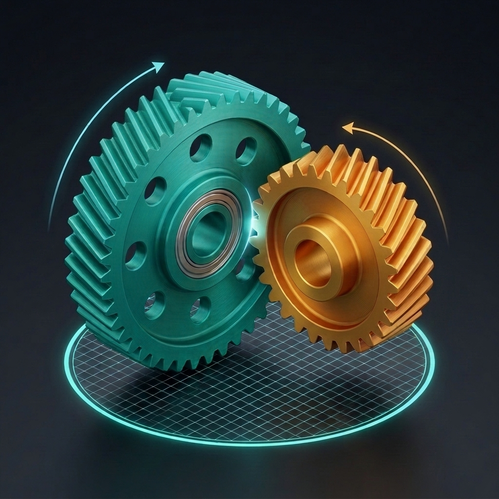

# Orca Gear Studio — Community Publishing & Marketplace Kit (PT-BR & EN)

<p align="center">
  
  &nbsp;&nbsp;&nbsp;&nbsp;
  
</p>

Este documento reúne todos os textos prontos para copiar e colar (**Português PT-BR** e **English EN**) para publicar o **Orca Gear Studio (`v1.2.0`)** no GitHub, no **OrcaCloud Plugin Hub** e nas comunidades de impressão 3D (Reddit, Discord, Fóruns, Printables e MakerWorld).

---

## 1. Metadados, Categoria & GitHub Topics

| Campo / Field | Valor / Value |
| :--- | :--- |
| **Plugin Name** | `Orca Gear Studio` |
| **Single-File PEP 723 Bundle** | `orca_gear_generator.py` *(com ícone vetorial `icon.svg` auto-materializado!)* |
| **Universal Wheel Package** | `orca_gear_generator-1.2.0-py3-none-any.whl` |
| **Version** | `1.2.0` |
| **Supported OS** | **Windows** (`win32`) & **macOS** (`darwin` Apple Silicon `arm64` / Intel `x86_64`) |
| **Requires OrcaSlicer** | `2.5.1+` (Embedded Python `>=3.12`, `numpy>=1.26`) |
| **Marketplace Category** | `3D Modeling & Generators` / `CAD & Mechanical Engineering` |
| **License** | `MIT` |

### GitHub Topics
```text
orca-plugin, orcaslicer, 3d-printing, gear-generator, parametric-design, involute-gear, mechanical-engineering, webgl2
```

---

## 2. Português (PT-BR) — Catálogo, Hub & Anúncio na Comunidade

### Descrição Curta (~240 caracteres)
```text
Estúdio CAD 3D nativo de engrenagens para OrcaSlicer (Windows & macOS): Retas, Helicoidais 45° sem suporte e Espinha de Peixe, simulação de giro 3D + Lupa 2D, Kit Rápido de Teste de Encaixe e envio em 1 clique direto para a mesa.
```

### Anúncio Pronto para Comunidades (PT-BR)
```markdown
⚙️ **[Plugin Gratuito / Open-Source] Orca Gear Studio v1.2.0 — Gere, simule o giro e calibre o encaixe de engrenagens Retas, Helicoidais 45° e Espinha de Peixe direto no OrcaSlicer (Windows & macOS)!**

Fala, pessoal! Acabei de lançar o **Orca Gear Studio (`v1.2.0`)**, um plugin nativo 100% offline para **OrcaSlicer 2.5.1+** que adiciona uma aba completa (e painel lateral!) de engenharia e simulação de engrenagens cilíndricas sem precisar abrir CAD externo:

✨ **Destaques:**
- ⚙️ **Involuta ISO 21771 Real:** Dentes Retos (*Spur*), **Helicoidais até 60°** (com atalho 45° sem suporte!) e **Espinha de Peixe (*Herringbone*, empuxo axial zero)**.
- 📏 **Ajuste Duplo de Altura dos Dentes (`fator × | mm`):** Controle *Addendum*, *Folga de Raiz*, *Fillet*, *Chanfro de Topo*, *Profile Shift* automático anti-undercut (até pinhões de 9 dentes!) e chanfro anti-pé-de-elefante.
- 🔄 **Micro Simulação de Giro 60 FPS (3D WebGL2 + Lupa 2D Sincronizada):** Play/Pause, RPM, avanço grau a grau (`0.1°`), Linha de Ação com pontos de contato móveis, vetores de força/empuxo axial e slider ao vivo de **Desvio de Centros (Δa)** detectando colisão/travamento em tempo real!
- 🧪 **Kit Físico de Teste Rápido (~10 min de impressão):** Gera 2 setores de 5 dentes + gabarito base com 2 pinos na distância exata entre centros + régua calibradora de furo/eixo com 4 folgas progressivas (`-0.05` a `+0.10 mm`).
- 🔩 **Furos e Corpo Independentes (Pinhão e Coroa):** Redondo, Eixo-D (NEMA), Duplo-D, Sextavado e Chaveta DIN + Cubo (*Hub*), alojamento de rolamento (ex.: 608ZZ) e furos circulares de alívio — tudo 100% estanque 2-manifold.
- 🚀 **1 Clique para a Mesa (Windows & macOS):** Injeta direto no Plater ativo em memória (sem subprocessos externos) e já ajusta perímetros maciços (4–6 paredes) + Gyroid 35%.
```

---

## 3. English (EN) — Store Listing & Community Announcement

### Short Catalog Description (~240 characters)
```text
Native 3D involute gear studio inside OrcaSlicer (Windows & macOS): Spur, 45° support-free Helical & Herringbone, 60 FPS 3D + 2D Loupe rotation simulation, live jamming check, 10-min FDM Fit-Test Kit, and 1-click Plater send.
```

### Ready-to-Post Community Announcement (EN)
```markdown
⚙️ **[Free & Open-Source Plugin] Orca Gear Studio v1.2.0 — Parametric Spur, 45° Helical & Herringbone Gears with Live Rotation Simulation & Fit-Test Kit Inside OrcaSlicer (Windows & macOS)!**

Hey everyone! Following up on Orca Vase Studio, I built **Orca Gear Studio (`v1.2.0`)**, a self-contained offline Python plugin for **OrcaSlicer 2.5.1+** (Windows & macOS) that brings precision ISO involute gear generation, live meshing simulation, and rapid FDM fit calibration right inside the slicer:

✨ **Highlights:**
- ⚙️ **True ISO 21771 Involute Geometry:** Spur, **Support-Free 45° Helical** (`0°–60°`), and **Herringbone** (zero net axial thrust) with automatic opposite-hand pairing.
- 📏 **Dual Tooth-Height Controls (`Factor × | mm`):** Tune Addendum, Root Clearance, Fillet Radius, Tip Relief, Elephant-Foot Chamfer, and Auto Anti-Undercut Profile Shift (`x1, x2`) down to 9-tooth micro-pinions.
- 🔄 **60 FPS Rotation Micro-Simulation (3D WebGL2 + Phase-Locked 2D Mesh Loupe):** Play/Pause, CW/CCW, RPM, `0.1°` manual angle scrubbing, moving contact dots along the Pressure Line of Action, 3D axial thrust vectors, and a live **Center-Distance Offset (Δa)** slider that highlights tooth collision/jamming while spinning!
- 🧪 **10-Minute Physical FDM Fit-Test Kit:** Prints two 5-tooth sectors + a 2-pin center-distance base jig + a 4-step shaft bore calibration gauge (`-0.05` to `+0.10 mm`) before committing hours of filament to full gears.
- 🔩 **Independent Shaft Bores & Body Features:** Round, D-Shaft (NEMA), Double-D, Hex, and DIN Keyway + Hubs, bearing counterbores (e.g. 608ZZ), and circular lightening holes — 100% strict 2-manifold watertight.
- 🚀 **1-Click Send to Plater (Windows & macOS):** In-process Plater injection (`WM_COPYDATA` on Windows, Cocoa main-queue `openFiles:` on macOS) + automatic mechanical slicer tuning (`4–6` solid tooth perimeters + 35% Gyroid).
```
