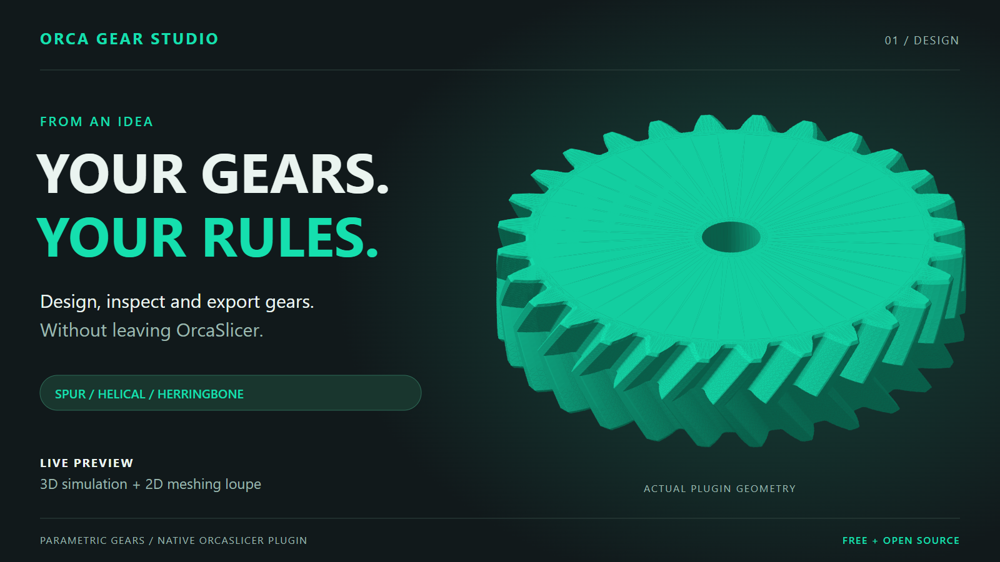
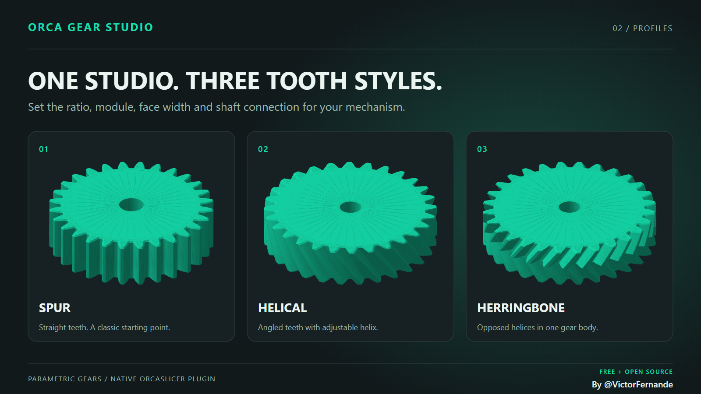
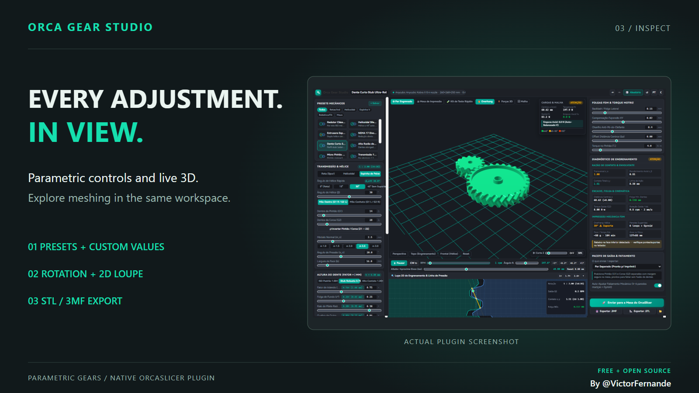
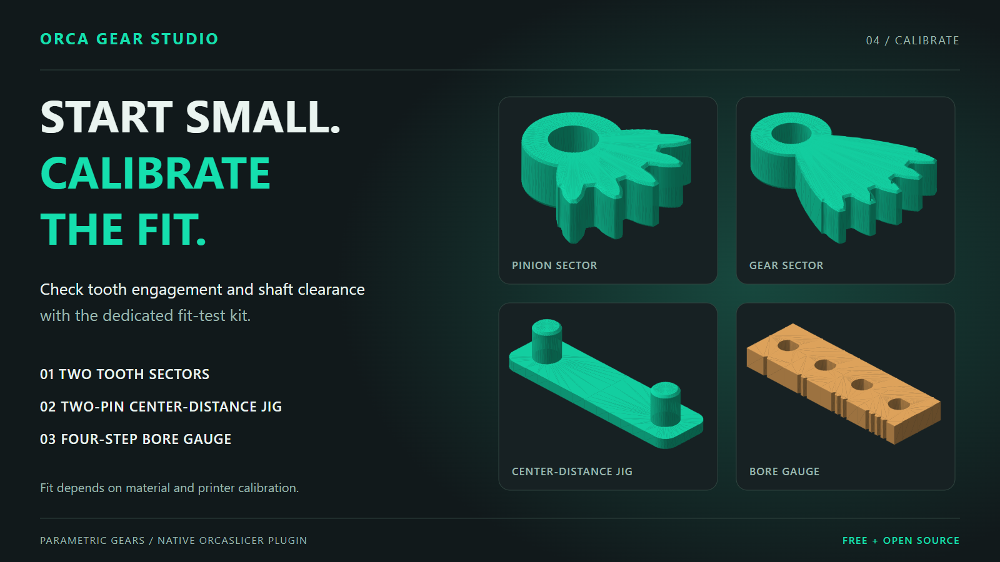
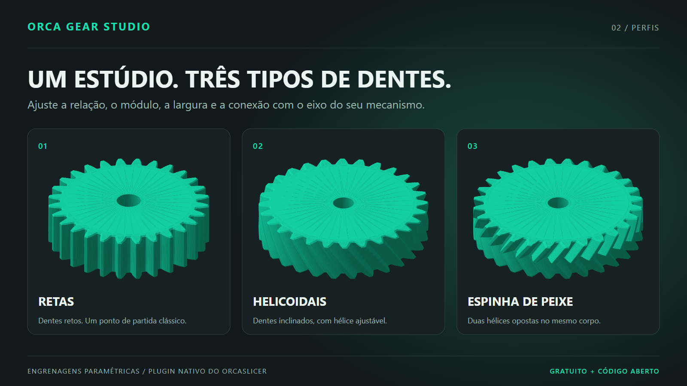
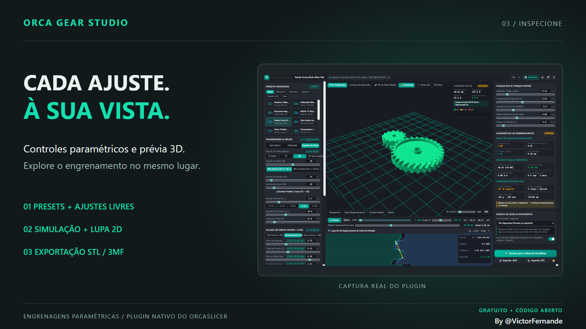
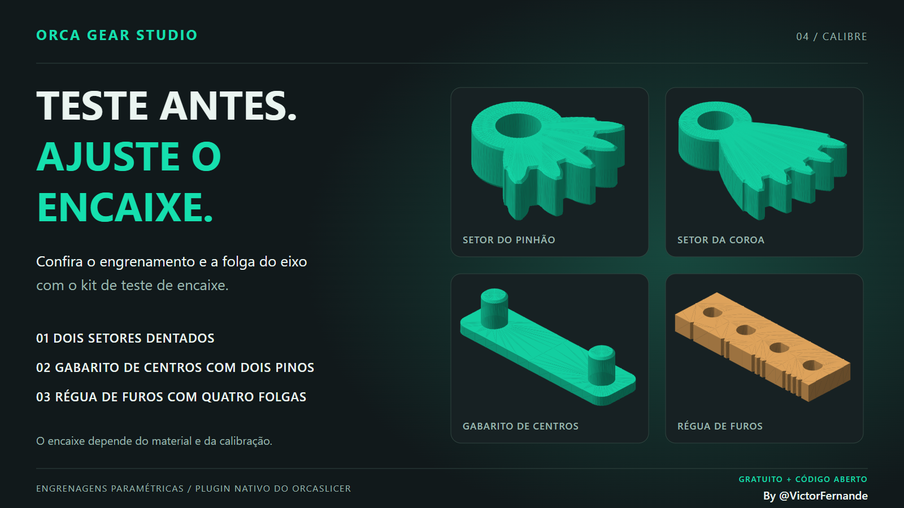

## English

**Your gears. Your rules. Without leaving OrcaSlicer.**

Design gears offline with parametric controls, 3D preview and rotation simulation. English and Portuguese interfaces. Native delivery on Windows and macOS.

### Three tooth styles

**Spur, helical and herringbone.** Adjust tooth count, module, pressure angle, face width, profile shift and clearances. Customize shaft bores, hubs, recesses and body lightening. Start with a preset or save your own.

### See every adjustment

Inspect contact in the **2D meshing loupe**. Control rotation direction and speed, step through the angle and explore center distance. Indicators help you assess clearance and possible interference.

### Calibrate the fit

Try two tooth sectors, a two-pin center-distance jig and a four-step bore gauge before printing the complete pair.

### Get started

1. Install and activate in **OrcaSlicer 2.5.1+**, then restart the application.
2. Open Gear Studio, select a preset and adjust your pair.
3. Check fit, then export **STL / 3MF** or send to the build plate.

Fit depends on calibration and material. Review orientation, supports and slicing settings before printing.

---

## Português

**Suas engrenagens, do seu jeito. Sem sair do OrcaSlicer.**

Projete offline com controles paramétricos, prévia 3D e simulação de giro. Interface em português e inglês. Envio nativo à mesa no Windows e no macOS.

### Três tipos de dentes

**Retas, helicoidais e espinha de peixe.** Ajuste dentes, módulo, ângulo de pressão, largura, correção de perfil e folgas. Personalize furos, cubos, rebaixos e alívio do corpo. Comece com um preset ou salve o seu.

### Veja cada ajuste

Confira o contato na **lupa 2D de engrenamento**. Controle direção e velocidade de giro, avance o ângulo e explore a distância entre centros. Os indicadores ajudam a avaliar folgas e possíveis interferências.

### Calibre o encaixe

Teste dois setores dentados, um gabarito de centros com dois pinos e uma régua de furos com quatro folgas antes de imprimir o par completo.

### Como começar

1. Instale e ative no **OrcaSlicer 2.5.1+** e reinicie o aplicativo.
2. Abra o Gear Studio, escolha um preset e ajuste o par.
3. Confira o encaixe e exporte **STL / 3MF** ou envie à mesa.

O encaixe físico depende da calibração e do material. Revise orientação, suportes e configurações antes de imprimir.

---

**By @VictorFernande · Free / Gratuito · MIT**

[GitHub & Docs](https://github.com/victorFernande/orca-gear-generator) · [Downloads](https://github.com/victorFernande/orca-gear-generator/releases) · [Issues](https://github.com/victorFernande/orca-gear-generator/issues)
