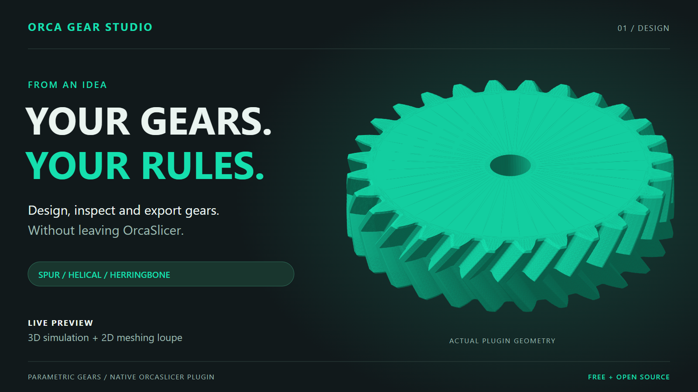
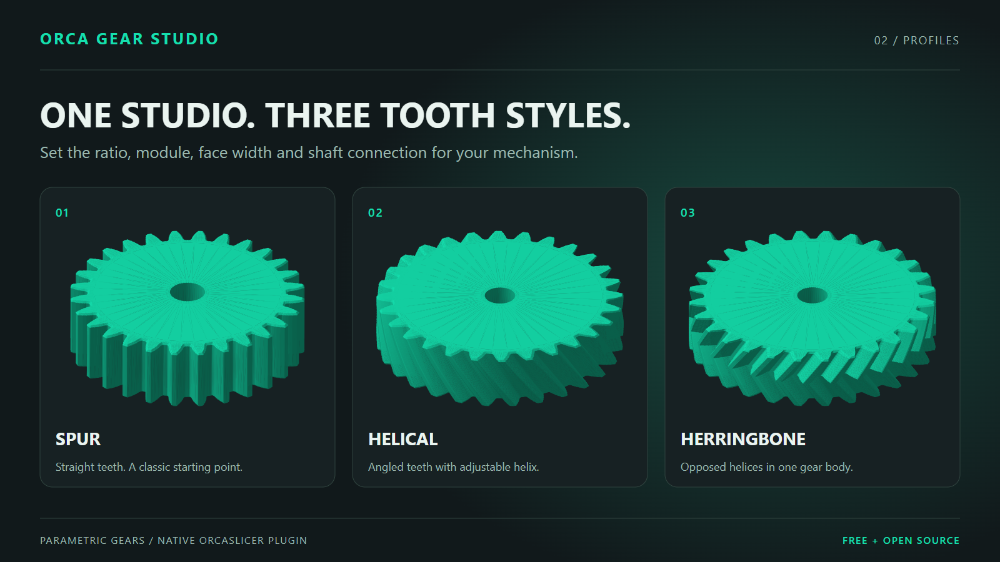
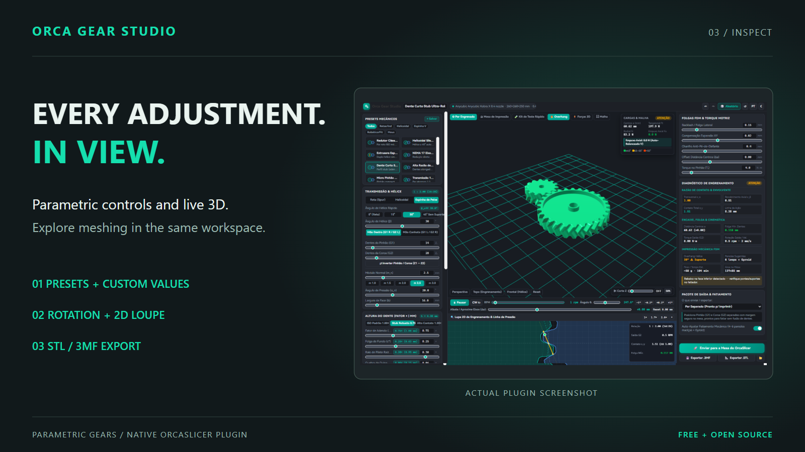
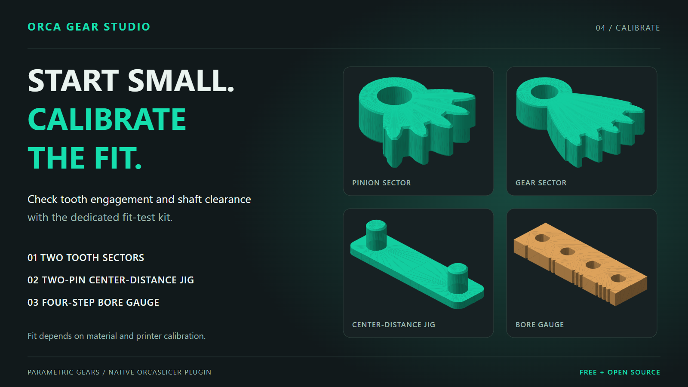

**Your gears. Your rules. Without leaving OrcaSlicer.**

Orca Gear Studio brings parametric design, a 3D preview, rotation simulation and gear export into one workspace. It runs offline, with English and Portuguese interfaces.

## Three tooth styles

- **Spur:** straight teeth for exploring transmission ratios and simple mechanisms.
- **Helical:** adjustable helix angle and opposite hands for the pinion and gear.
- **Herringbone:** opposing helices in a single gear body.

Adjust tooth count, module, pressure angle, face width, tooth height, profile shift and clearances. Start with a preset or save your own configuration.

## See what you are changing

Inspect the pair in 3D and follow contact in the **2D meshing loupe**. Control rotation direction and speed, step through the angle manually and explore center distance.

Indicators help you inspect clearances, contact ratio and possible interference. Configure round, D-shaft, double-D, hex or keyway bores, hubs, counterbores and body lightening.

## Calibrate before printing the full pair

The **fit-test kit** generates two tooth sectors, a two-pin center-distance jig and a bore gauge with four progressive clearances. Check the fit with your printer and filament before producing complete gears.

## From design to the build plate

Export **STL** or **multi-object 3MF**, or use native delivery to the build plate on Windows and macOS. Select the pair, an individual gear, the fit-test kit or the available full set.

Fit depends on printing and material. Review orientation, supports and settings before printing. Diagnostics and suggested slicing settings support design inspection.

## Get started

1. Install and activate in **OrcaSlicer 2.5.1 or later**. Close and reopen the application after installation or an update.
2. Open the **Gear Generator** tab or the Orca Gear Studio dock panel.
3. Choose a preset, adjust the transmission and inspect the preview.
4. Run a fit test when needed, then export or send the parts to the build plate.

**Free and open source under the MIT license.**

[Source and documentation](https://github.com/victorFernande/orca-gear-generator) · [Downloads](https://github.com/victorFernande/orca-gear-generator/releases) · [Report an issue](https://github.com/victorFernande/orca-gear-generator/issues)
