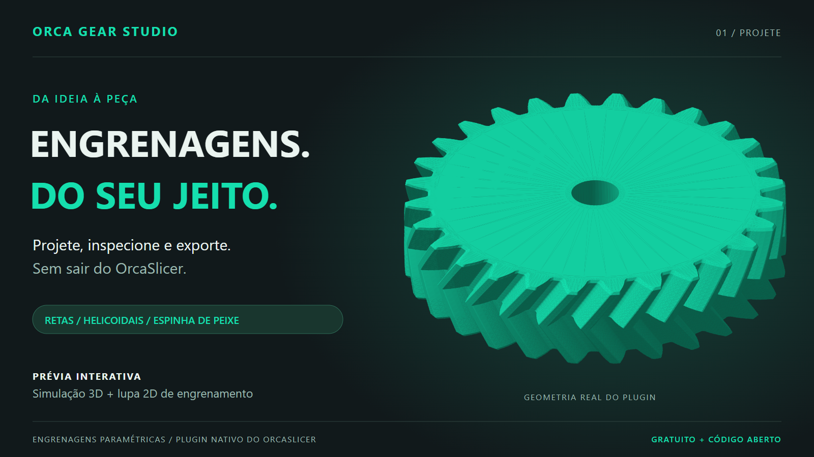
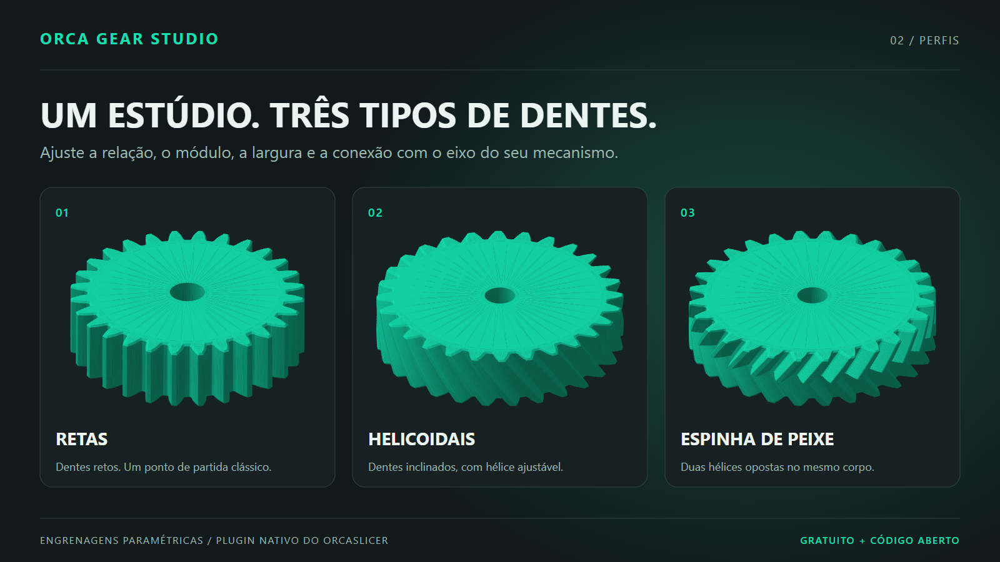
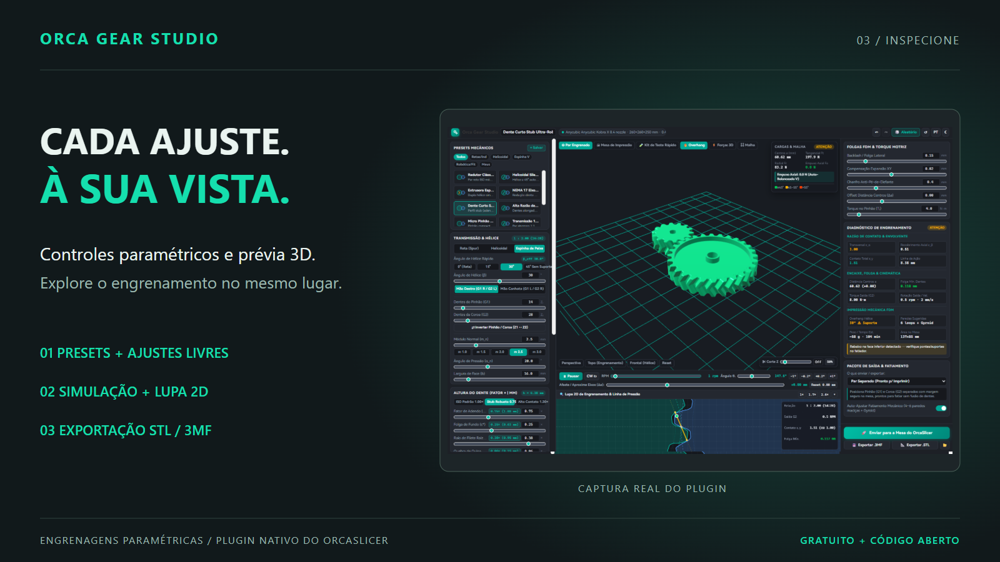
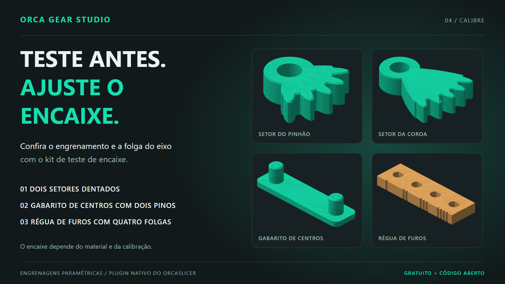

**Suas engrenagens, do seu jeito. Sem sair do OrcaSlicer.**

O Orca Gear Studio reúne projeto paramétrico, prévia 3D, simulação de giro e exportação de engrenagens em um só lugar. Funciona offline, com interface em português e inglês.

## Três tipos de dentes

- **Retas:** dentes retos para explorar relações de transmissão e mecanismos simples.
- **Helicoidais:** ângulo de hélice ajustável e mãos opostas entre pinhão e coroa.
- **Espinha de peixe:** duas hélices opostas no mesmo corpo.

Ajuste dentes, módulo, ângulo de pressão, largura, altura dos dentes, correção de perfil e folgas. Comece com um preset ou salve sua própria configuração.

## Veja o que está ajustando

Inspecione o par em 3D e acompanhe o contato na **lupa 2D de engrenamento**. Controle direção e velocidade de giro, avance o ângulo manualmente e explore a distância entre centros.

Os indicadores ajudam a observar folgas, razão de contato e possíveis interferências. Configure também furos circular, D, duplo D, sextavado ou chaveta, cubos, alojamentos e alívio do corpo.

## Calibre antes de imprimir o par completo

O **kit de teste de encaixe** gera dois setores dentados, um gabarito de centros com dois pinos e uma régua de furos com quatro folgas progressivas. Experimente o ajuste com sua impressora e seu filamento antes de produzir as engrenagens completas.

## Do projeto para a mesa

Exporte **STL** ou **3MF com objetos separados**, ou use o envio nativo para a mesa no Windows e no macOS. Escolha o par, uma engrenagem, o kit de teste ou o conjunto disponível no plugin.

O encaixe depende da impressão e do material. Revise orientação, suportes e configurações antes de imprimir. Os diagnósticos e as sugestões de fatiamento auxiliam a avaliação do projeto.

## Como começar

1. Instale e ative no **OrcaSlicer 2.5.1 ou superior**. Feche e abra o aplicativo após instalar ou atualizar.
2. Abra a aba **Gerador de Engrenagens** ou o painel lateral do Orca Gear Studio.
3. Escolha um preset, ajuste a transmissão e confira a prévia.
4. Faça um teste de encaixe quando necessário e exporte ou envie as peças à mesa.

**Gratuito e de código aberto, sob licença MIT.**

[Código e documentação](https://github.com/victorFernande/orca-gear-generator) · [Downloads](https://github.com/victorFernande/orca-gear-generator/releases) · [Relatar problema](https://github.com/victorFernande/orca-gear-generator/issues)
