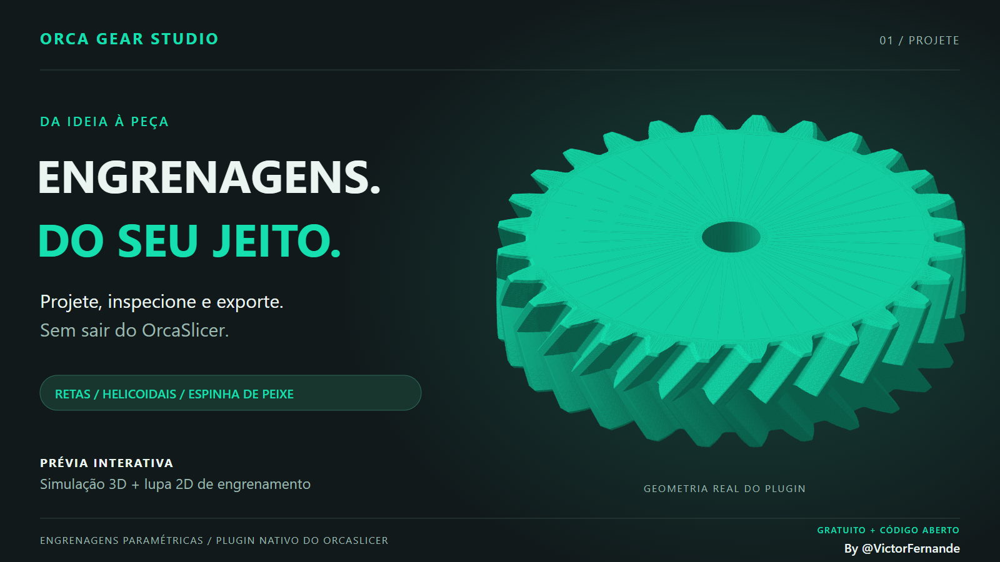

# Orca Gear Studio — material para OrcaCloud

Quatro artes em **1600 × 900**, cada uma em **português e inglês**, com descrições prontas para colar no OrcaCloud. O material segue o formato observado na descrição do Spooler: imagens PNG públicas no GitHub inseridas entre parágrafos por Markdown.

## Textos prontos para colar

- **Campo único bilíngue, aplicado no OrcaCloud:** [ORCACLOUD_BILINGUAL.md](ORCACLOUD_BILINGUAL.md)
- **Português:** [ORCACLOUD_PT-BR.md](ORCACLOUD_PT-BR.md)
- **English:** [ORCACLOUD_EN.md](ORCACLOUD_EN.md)
- **Prévia local com troca de idioma:** [PREVIEW.html](PREVIEW.html)

Os arquivos `ORCACLOUD_*.md` já contêm os endereços HTTPS diretos das imagens. O editor conferido no Gear usa um único campo de descrição; nele, use **ORCACLOUD_BILINGUAL.md**, que organiza os dois idiomas em seções e contém as oito imagens. As versões individuais continuam disponíveis para outros usos. Os textos ficam abaixo da meta de 4.000 caracteres usada pelo autor da referência; esse valor não foi confirmado como limite do editor.

Os arquivos `DESCRIPTION_*.md` são as fontes locais, com caminhos relativos para revisão no repositório. Use os arquivos **ORCACLOUD** ao copiar para o catálogo.

## As oito imagens

| Arte | Português | English |
| --- | --- | --- |
| Capa | [01-gear-studio-pt-BR.png](../../assets/marketplace/01-gear-studio-pt-BR.png) | [01-gear-studio-en.png](../../assets/marketplace/01-gear-studio-en.png) |
| Tipos de dentes | [02-tooth-styles-pt-BR.png](../../assets/marketplace/02-tooth-styles-pt-BR.png) | [02-tooth-styles-en.png](../../assets/marketplace/02-tooth-styles-en.png) |
| Interface | [03-live-workspace-pt-BR.png](../../assets/marketplace/03-live-workspace-pt-BR.png) | [03-live-workspace-en.png](../../assets/marketplace/03-live-workspace-en.png) |
| Kit de encaixe | [04-fit-test-kit-pt-BR.png](../../assets/marketplace/04-fit-test-kit-pt-BR.png) | [04-fit-test-kit-en.png](../../assets/marketplace/04-fit-test-kit-en.png) |

As fontes SVG editáveis estão na mesma pasta. Todos os títulos, legendas e textos editoriais das artes foram traduzidos. A captura real da interface, obtida de `assets/Gear2.png`, permanece em português nas duas versões para preservar o registro original.

## Inserir no OrcaCloud

1. Abra a edição do seu Gear no OrcaCloud.
2. Cole `ORCACLOUD_BILINGUAL.md` no campo de descrição.
3. Confira os quatro banners em inglês e os quatro em português na prévia do catálogo.
4. Salve quando a apresentação estiver revisada.

Em 18/11/2026, a versão bilíngue foi salva no [Gear no OrcaCloud](https://cloud.orcaslicer.com/app/plugins/shared-plugins/59f49437-eb86-401c-b637-a0842e86070a). A página confirmou a atualização, e o carregamento das oito imagens de 1600 × 900 foi verificado. Nome, versão 1.3.1, arquivos do plugin e anexos existentes foram mantidos.

As imagens da descrição são independentes da galeria de anexos. Como na referência, não é necessário anexar as mesmas imagens para que os links Markdown funcionem. O modelo usado é:

```markdown

```

## Origem e limites

As engrenagens ilustradas e as quatro peças do kit vêm das malhas reais geradas pelo próprio plugin. São vistas editoriais, não fotografias de peças impressas. A captura original, o código executável, a instalação e a versão do plugin foram preservados. Tempos de impressão e taxa de quadros não são anunciados como garantidos.

Referências de formato: [descrição do Spooler](https://cloud.orcaslicer.com/app/plugins/subscribed-plugins/5c523246-d53c-44bc-a129-fe2470da6368) e [fonte Markdown do autor](https://github.com/bloodf/spooler/blob/main/docs/orca-cloud-description.md). As artes e os textos do Gear são próprios.

## Reproduzir

Com Python 3.12+, NumPy e ferramentas locais de autoria Node.js/Playwright/Chromium:

```console
python -B scripts/build_marketplace_artwork.py
node scripts/render_marketplace_artwork.cjs
python -B scripts/build_marketplace_preview.py
```

`ORCA_PLAYWRIGHT_MODULE` e `ORCA_CHROMIUM_PATH` selecionam instalações alternativas do renderizador. As ferramentas de autoria não são dependências do plugin. O renderizador confere se os textos permanecem dentro da imagem; a prévia local permite revisar os dois idiomas.
